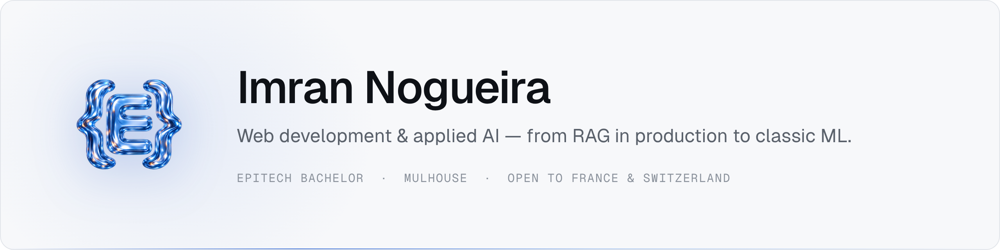
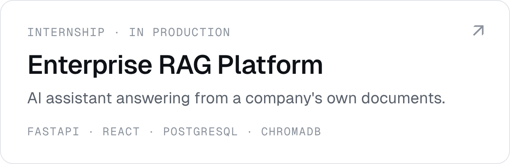
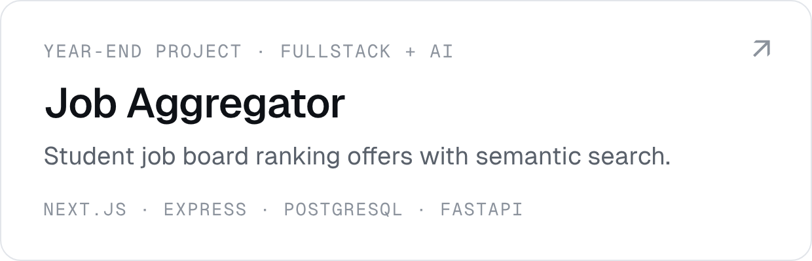
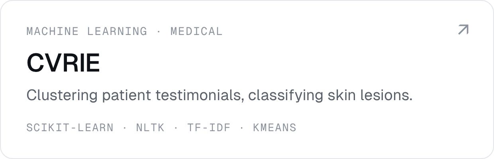
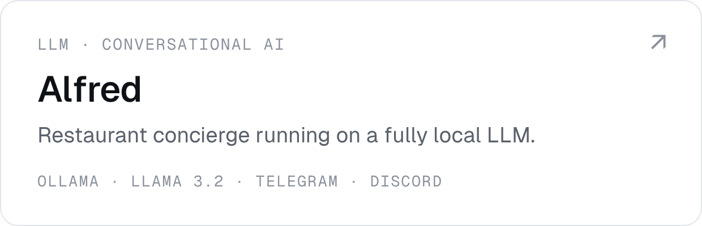
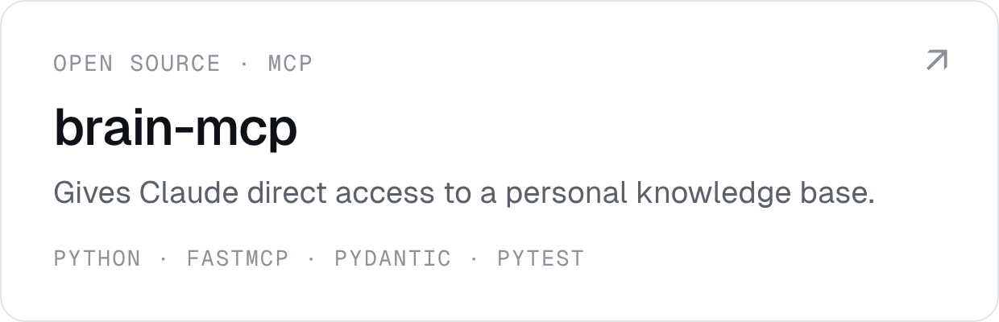
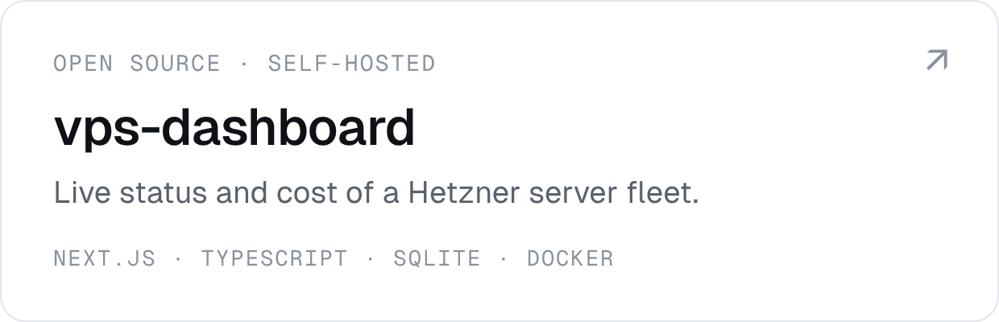

<a href="https://imran-nogueira.github.io"><picture><source media="(prefers-color-scheme: dark)" srcset="assets/profile-banner-dark.png"></picture></a>

 

Looking for an **internship from April 2027**, then a **work-study position for 2027–2028**, in **France or Switzerland (Basel, Geneva)**.

#### Featured

<a href="https://github.com/imran-nogueira/enterprise-rag-platform"><picture><source media="(prefers-color-scheme: dark)" srcset="assets/card-enterprise-rag-platform-dark.png"></picture></a>
<a href="https://github.com/imran-nogueira/job-aggregator"><picture><source media="(prefers-color-scheme: dark)" srcset="assets/card-job-aggregator-dark.png"></picture></a>

<a href="https://github.com/imran-nogueira/cvrie-medical-ai"><picture><source media="(prefers-color-scheme: dark)" srcset="assets/card-cvrie-medical-ai-dark.png"></picture></a>
<a href="https://github.com/imran-nogueira/alfred-llm-concierge"><picture><source media="(prefers-color-scheme: dark)" srcset="assets/card-alfred-llm-concierge-dark.png"></picture></a>

<a href="https://github.com/imran-nogueira/brain-mcp"><picture><source media="(prefers-color-scheme: dark)" srcset="assets/card-brain-mcp-dark.png"></picture></a>
<a href="https://github.com/imran-nogueira/vps-dashboard"><picture><source media="(prefers-color-scheme: dark)" srcset="assets/card-vps-dashboard-dark.png"></picture></a>

#### Also built

- [NextBuy](https://github.com/imran-nogueira/nextbuy-ecommerce-ml) — sales analysis and product recommendations for an online grocery store
- [TARDIS](https://github.com/imran-nogueira/tardis-train-delay-forecast) — predicting train delays in France
- [Bookworm](https://github.com/imran-nogueira/bookworm-nlp-engine) — automatic analysis of classic books
- [Next Level](https://github.com/imran-nogueira/nextlevel-gaming-social) — a social app for gamers, from user research to MVP

#### Stack

| | Proficient | Working knowledge |
|---|---|---|
| **Languages** | Python · TypeScript · JavaScript | Java |
| **AI & data** | RAG · vector databases | LLM APIs · local LLMs (Ollama) · prompt engineering · embeddings · NLP · pandas · scikit-learn · Streamlit |
| **Backend** | FastAPI · Node.js / Express · API security hardening | n8n |
| **Frontend** | React · Next.js · HTML / CSS | Tailwind CSS · Vite |
| **Databases** | PostgreSQL | MongoDB · MySQL · Supabase |
| **Engineering** | Docker · Git · automated testing | |

#### Contact

**imran.nogueira@gmail.com** · [Portfolio](https://imran-nogueira.github.io)

School projects keep their source code private under Epitech's academic policy — each one has a detailed write-up, and I'm happy to walk you through the code on request.
